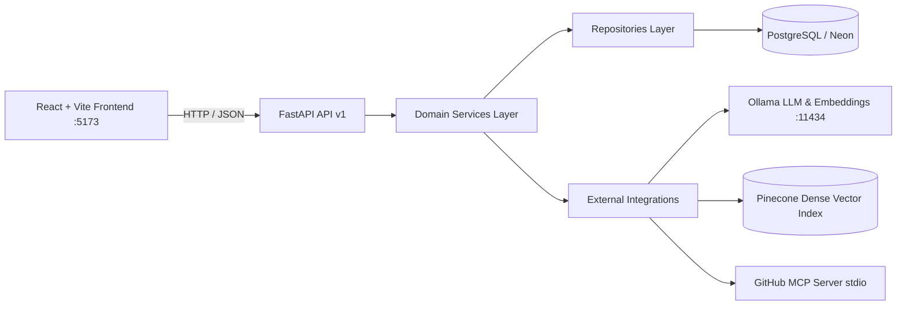

# AI Interview Preparation Platform — Backend

Enterprise FastAPI backend for the AI Interview Preparation Platform, powered by **FastAPI**, **SQLAlchemy 2.0**, **Alembic**, **PostgreSQL (Neon)**, **Pinecone**, **Ollama** (`qwen2.5:1.5b` & `nomic-embed-text`), and **GitHub MCP** (`mcp` stdio client).

---

## Architecture Overview



### Layered Responsibilities

- **API Layer (`app/api/routes/`, `app/api/v1/router.py`)**: Thin HTTP adapters handling request parsing, Pydantic schema validation, dependency injection, and mapping domain exceptions to HTTP responses via `app/core/exceptions.py`.
- **Core (`app/core/`)**: Centralized configuration (`config.py`), logging (`logging.py`), and shared HTTP exception translators (`exceptions.py`).
- **Services (`app/services/`)**: Business workflows for interview question generation, answer evaluation, session lifecycles, PDF/URL ingestion, hybrid search (dense + BM25 + RRF), reranking, RAG Triad evaluation, and repository-grounded question generation.
- **Repositories (`app/repositories/`)**: Encapsulates SQLAlchemy 2.0 queries and transaction/rollback boundaries for `InterviewSession`, `InterviewQuestion`, `AnswerEvaluation`, and `DocumentSource`.
- **Integrations (`app/integrations/`)**: Protocol and client helpers isolated from core domain logic (Ollama model tag discovery and GitHub MCP read-only whitelist & payload decoders).
- **Database & Models (`app/db/`, `app/models/`)**: Declarative SQLAlchemy models, URL normalization/credential masking, and dual-mode DB session management (`get_db` + `get_db_optional`).
- **Schemas (`app/schemas/`)**: Pydantic v2 request/response contracts and field validators.
- **Utilities (`app/utils/`)**: Shared markdown-fence stripping / JSON parsing (`json_parser.py`), HTML text extraction (`html_parser.py`), and identifier/enum helpers (`identifiers.py`).

---

## Project Structure

```text
BackEnd/
├── app/
│   ├── main.py                         # FastAPI app initialization, CORS, global 500 handler
│   ├── api/
│   │   ├── routes/
│   │   │   ├── health.py               # /health, /health/ollama, /health/db
│   │   │   ├── interview.py            # Standalone Q&A, RAG Q&A, RAG eval, session endpoints
│   │   │   ├── documents.py            # PDF upload, URL ingest, status, document-grounded Q&A
│   │   │   ├── sources.py              # Unified source URL ingest, status, listing, sessions
│   │   │   └── github.py               # GitHub MCP validation, README, files, repo Q&A
│   │   └── v1/
│   │       └── router.py               # Aggregates API v1 routers
│   ├── core/
│   │   ├── config.py                   # Pydantic Settings (env-driven configuration)
│   │   ├── exceptions.py               # Shared domain-to-HTTP exception translators
│   │   └── logging.py                  # Centralized structured logging configuration
│   ├── db/
│   │   ├── base.py                     # SQLAlchemy DeclarativeBase
│   │   └── session.py                  # Engine, sessionmaker, get_db, get_db_optional
│   ├── models/
│   │   └── interview.py                # InterviewSession, InterviewQuestion, AnswerEvaluation, DocumentSource
│   ├── repositories/
│   │   ├── interview_repository.py     # SQLAlchemy persistence for sessions & evaluations
│   │   └── source_repository.py        # SQLAlchemy persistence for DocumentSource records
│   ├── schemas/
│   │   ├── document.py                 # Document upload, URL ingestion, source schemas
│   │   ├── evaluation.py               # RAG Triad evaluation request/response schemas
│   │   ├── github.py                   # GitHub repo & MCP response schemas
│   │   ├── health.py                   # Health check schemas
│   │   ├── interview.py                # Question, evaluation, and RAG schemas
│   │   └── session.py                  # Session lifecycle and summary schemas
│   ├── services/
│   │   ├── answer_evaluation_service.py # Candidate answer evaluation orchestration
│   │   ├── chunking_service.py         # Overlap-aware semantic text chunker
│   │   ├── document_service.py         # End-to-end PDF upload -> Pinecone -> Source pipeline
│   │   ├── embedding_service.py        # Ollama 768-dim embedding client with batching & fallback
│   │   ├── github_mcp_service.py       # Read-only GitHub MCP stdio client service
│   │   ├── hybrid_search_service.py    # Pure-Python BM25Okapi + Reciprocal Rank Fusion
│   │   ├── ollama_service.py           # Async HTTPX Ollama chat & answer evaluation client
│   │   ├── pdf_service.py              # PDF magic-header, encryption, size/page & pypdf extractor
│   │   ├── pinecone_service.py         # Pinecone 768-dim dense vector upsert/query/delete
│   │   ├── question_generation_service.py # Standalone & session question generation
│   │   ├── rag_eval_service.py         # RAG Triad judge (LLM + heuristic fallback)
│   │   ├── rag_question_service.py     # Document & multi-question source-grounded RAG service
│   │   ├── repo_question_service.py    # GitHub repository-grounded question generator
│   │   ├── reranker_service.py         # Post-retrieval reranking (FlashRank / Ollama / heuristic)
│   │   ├── retrieval_service.py        # Dense retrieval + hybrid fusion + reranking pipeline
│   │   ├── session_service.py          # Interview session state machine & summary aggregator
│   │   ├── source_service.py           # Source metadata tracking & readiness validation
│   │   └── url_service.py              # SSRF-safe webpage & GitHub URL ingestion
│   ├── integrations/
│   │   ├── github_mcp/
│   │   │   └── protocol.py             # MCP read-only whitelist & content/error decoders
│   │   └── ollama/
│   │       └── helpers.py              # Shared /api/tags model discovery helpers
│   └── utils/
│       ├── html_parser.py              # Standard-library HTML text & title extractor
│       ├── identifiers.py              # Document ID normalization & enum serialization
│       └── json_parser.py              # LLM markdown-fence stripping & safe JSON decoding
├── alembic/
│   ├── env.py                          # Alembic migration environment
│   └── versions/                       # Versioned database schema migrations
├── tests/                              # Offline unit & API integration tests (pytest)
├── alembic.ini
├── requirements.txt
└── .env.example
```

---

## Setup & Installation

### 1. Create and Activate Virtual Environment

```bash
cd BackEnd
python3 -m venv .venv
source .venv/bin/activate
```

### 2. Install Dependencies

```bash
pip install -r requirements.txt
```

### 3. Configure Environment Variables

Copy `.env.example` to `.env` and fill in your credentials (never commit `.env`):

```bash
cp .env.example .env
```

Key environment variables:

| Variable | Description | Default |
|---|---|---|
| `APP_NAME` | Application title | `AI Interview Preparation Platform` |
| `APP_ENV` | Environment (`development`, `production`) | `development` |
| `API_V1_PREFIX` | API route prefix | `/api/v1` |
| `CORS_ORIGINS` | Allowed frontend origins (CSV or JSON list) | `http://localhost:5173,http://127.0.0.1:5173` |
| `OLLAMA_BASE_URL` | Local Ollama server URL | `http://localhost:11434` |
| `OLLAMA_MODEL` | Chat completion model | `qwen2.5:1.5b` |
| `OLLAMA_EMBEDDING_MODEL` | Dense embedding model (768-dim) | `nomic-embed-text` |
| `DATABASE_URL` | Neon PostgreSQL DSN (`postgresql+psycopg://...`) | `None` (in-memory fallback if unset) |
| `PINECONE_API_KEY` | Pinecone API key | `None` |
| `PINECONE_INDEX_NAME` | Standard dense vector index name | `ai-interview-prep-v2` |
| `PINECONE_DIMENSION` | Vector dimension matching `nomic-embed-text` | `768` |
| `GITHUB_TOKEN` / `GITHUB_PERSONAL_ACCESS_TOKEN` | Optional read-only PAT for GitHub MCP | `None` |

Ensure Ollama models are pulled locally:

```bash
ollama pull qwen2.5:1.5b
ollama pull nomic-embed-text
```

---

## Running the Application

```bash
uvicorn app.main:app --reload --host 0.0.0.0 --port 8000
```

- Swagger UI: `http://localhost:8000/docs`
- ReDoc: `http://localhost:8000/redoc`

---

## Database Migrations (Alembic)

With `DATABASE_URL` configured in `.env`:

```bash
# Apply all pending migrations
alembic upgrade head

# Check current migration revision
alembic current
```

> If `DATABASE_URL` is omitted, the API operates in in-memory mode for local development and tests.

---

## Running Tests

The test suite uses isolated SQLite in-memory databases and mocked external clients (Ollama, Pinecone, GitHub MCP) so it runs deterministically offline:

```bash
pytest -v
```

To also run the live Neon PostgreSQL connectivity test, set `NEON_DATABASE_URL` in your environment.

---

## RAG & GitHub MCP Integration Flow

1. **Ingestion (`DocumentService` / `URLService`)**:
   - **PDFs**: Validated for magic header, encryption, page/size limits (`PDFService`), extracted, chunked (`TextChunkingService`), embedded via Ollama `nomic-embed-text` (`EmbeddingService`), and upserted into Pinecone (`PineconeService`) with `document_id` isolation metadata.
   - **Public URLs**: Validated against SSRF (private/loopback/metadata IPs blocked on initial host and every HTTP redirect hop), extracted via `HTMLTextExtractor`, chunked, embedded, and indexed in Pinecone.
   - **GitHub URLs & Repo Inspection (`GitHubMCPService`)**: Connects over `stdio` to the MCP server using the `mcp` SDK, enforces `READ_ONLY_TOOL_WHITELIST`, guards against path traversal, and feeds README + key source files into either Pinecone indexing (`URLService`) or direct repo-grounded question generation (`RepoQuestionService`).
2. **Retrieval & Grounded Generation (`RetrievalService` -> `RAGQuestionService`)**:
   - Queries Pinecone with a strict `document_id` metadata filter, filters by `RAG_MIN_RELEVANCE_SCORE`, applies optional BM25 + RRF hybrid fusion (`HybridSearchService`) and post-retrieval reranking (`RerankerService`), and generates citation-backed interview questions via `OllamaService`.
   - `RAGEvaluationService` evaluates generated questions against retrieved chunks using the RAG Triad (Faithfulness, Context Relevance, Question Relevance).
