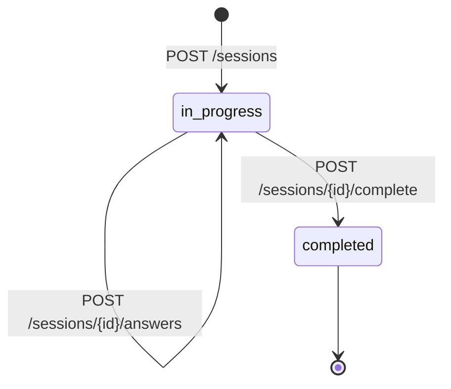

# AI Interview Preparation Platform - Backend (Day 4: Interview Session Management)

A robust, lightweight Python backend for an AI-powered technical interview preparation platform. Built with **FastAPI**, **HTTPX**, and a local **Ollama** runtime hosting **Qwen 2.5 (`qwen2.5:1.5b`)**.

---

## 🏗️ Architecture Overview

```mermaid
graph LR
    Client[Client / Frontend / Curl] -->|HTTP / JSON| FastAPI[FastAPI Backend :8000]
    FastAPI -->|In-Memory Store| SessionService[Session Management Service]
    FastAPI -->|HTTPX Async Client| Ollama[Ollama Local Runtime :11434]
    Ollama -->|Inference| Qwen[Qwen 2.5 Model (1.5B)]
```

### Key Highlights
- **Direct Local AI Integration**: Communicates directly with Ollama's native `/api/chat` and `/api/tags` endpoints via HTTPX. No heavy AI wrappers (like LangChain) are used so you can understand the exact HTTP protocol and request/response lifecycles.
- **Fail-Safe Health Checks**: Comprehensive health monitoring that verifies both backend operational status and local Ollama model availability, returning standard HTTP `503 Service Unavailable` if the AI engine is unreachable.
- **Interview Session Management (Day 4)**: Stateful orchestration supporting multi-question interviews with progress tracking, sequential question retrieval, per-question answer evaluation, and aggregated summaries.
- **Strong Typing & Validation**: Strict request/response schemas using Pydantic V2.
- **Test-Driven Design**: 100% mocked automated test suite (57 tests) using `pytest` and FastAPI's `TestClient` that requires no live Ollama instance to run in CI/CD.

---

## 📋 Prerequisites

Before running the backend, make sure you have:
1. **Python**: Python 3.10 or higher (Tested with Python 3.14.6).
2. **Ollama**: Installed and running locally.
   - Download: [ollama.com](https://ollama.com)
   - Verify installation:
     ```bash
     ollama --version
     ```
3. **Qwen 2.5 Model**: Verify that `qwen2.5:1.5b` is pulled:
   ```bash
   ollama list
   ```
   If not yet installed:
   ```bash
   ollama pull qwen2.5:1.5b
   ```

---

## 📁 Project Structure

```
backend/
├── app/
│   ├── __init__.py
│   ├── main.py                     # FastAPI application factory & middleware
│   ├── core/
│   │   ├── __init__.py
│   │   └── config.py               # Pydantic Settings & environment variable loader
│   ├── schemas/
│   │   ├── __init__.py             # Central schema exports
│   │   ├── health.py               # Health check response schemas
│   │   ├── interview.py            # Question generation & evaluation schemas
│   │   └── session.py              # Session management & summary schemas
│   ├── services/
│   │   ├── __init__.py             # Service exports
│   │   ├── ollama_service.py       # Async HTTPX client for Ollama LLM integration
│   │   └── session_service.py      # In-memory interview session manager
│   └── api/
│       ├── __init__.py
│       └── routes/
│           ├── __init__.py
│           ├── health.py           # Backend & Ollama health check endpoints
│           └── interview.py        # Question, evaluation & session endpoints
├── tests/
│   ├── __init__.py
│   ├── test_health.py              # Health check endpoint unit tests (mocked)
│   ├── test_interview.py           # Question & evaluation endpoint unit tests (mocked)
│   └── test_session.py             # Session management lifecycle tests (mocked)
├── .env.example                    # Safe environment template
├── .env                            # Local environment configuration (git-ignored)
├── .gitignore                      # Git ignore file
├── requirements.txt                # Pinned Python dependencies
└── README.md                       # Documentation and run instructions
```

---

## 🚀 Quickstart Guide

### 1. Set Up Virtual Environment

Always use a Python virtual environment to keep project dependencies isolated:

```bash
# Navigate to the backend directory
cd /Users/rahul/Documents/Ai-Interview-Platform/BackEnd

# Create a virtual environment
python3 -m venv .venv

# Activate the virtual environment
# On macOS / Linux:
source .venv/bin/activate
# On Windows (PowerShell):
# .venv\Scripts\Activate.ps1
```

### 2. Install Dependencies

Install the pinned dependencies:

```bash
pip install -r requirements.txt
```

### 3. Configure Environment Variables

Copy `.env.example` to `.env`:

```bash
cp .env.example .env
```

Contents of `.env`:
```env
APP_NAME="AI Interview Preparation Platform"
APP_ENV=development
API_V1_PREFIX=/api/v1
OLLAMA_BASE_URL=http://localhost:11434
OLLAMA_MODEL=qwen2.5:1.5b
OLLAMA_TIMEOUT_SECONDS=60.0
```

### 4. Ensure Ollama is Running

Make sure Ollama is active in the background:

```bash
ollama list
```

If Ollama is not running, start it:
```bash
ollama serve
```

---

## 🏃 Running the Backend Server

Start the FastAPI application with auto-reload:

```bash
uvicorn app.main:app --reload --host 127.0.0.1 --port 8000
```

The server will be available at `http://127.0.0.1:8000`.

Interactive documentation:
- **Swagger UI**: [http://127.0.0.1:8000/docs](http://127.0.0.1:8000/docs)
- **ReDoc**: [http://127.0.0.1:8000/redoc](http://127.0.0.1:8000/redoc)

---

## 🔄 Interview Session Management (Day 4)

### Session Lifecycle State Machine



### ⚠️ Storage & Persistence Architecture Notice
> [!NOTE]
> **In-Memory Store Disclaimer**:
> Sessions are managed via an in-memory dictionary in [`SessionService`](file:///Users/rahul/Documents/Ai-Interview-Platform/BackEnd/app/services/session_service.py).
> All sessions and evaluation records are held in application memory and **are lost when the backend server restarts**.
> This design keeps the development setup simple and dependency-free at this milestone without requiring a database.
> Future milestones will introduce persistent database storage (e.g., PostgreSQL or MongoDB).

---

### Session API Endpoints

| Method | Endpoint | Description |
| :--- | :--- | :--- |
| `POST` | `/api/v1/interview/sessions` | Create a new in-progress interview session |
| `GET` | `/api/v1/interview/sessions/{session_id}` | Retrieve session details, progress, and question history |
| `POST` | `/api/v1/interview/sessions/{session_id}/next-question` | Generate the next tailored question using Qwen 2.5 |
| `POST` | `/api/v1/interview/sessions/{session_id}/answers` | Submit candidate answer and evaluate against rubric |
| `POST` | `/api/v1/interview/sessions/{session_id}/complete` | Mark session completed and calculate overall summary |

---

### Step-by-Step Session Walkthrough

#### 1. Create a New Session
```bash
curl -X POST http://127.0.0.1:8000/api/v1/interview/sessions \
  -H "Content-Type: application/json" \
  -d '{
    "role": "Frontend Developer",
    "experience_level": "Junior",
    "difficulty": "Medium",
    "topic": "React Hooks",
    "question_type": "Technical",
    "total_questions": 3
  }'
```

**Response (`201 Created`):**
```json
{
  "session_id": "e058e49c-d69a-4ffb-b949-ded55736acca",
  "role": "Frontend Developer",
  "experience_level": "Junior",
  "difficulty": "Medium",
  "topic": "React Hooks",
  "question_type": "Technical",
  "total_questions": 3,
  "completed_questions": 0,
  "current_question_number": 0,
  "status": "in_progress",
  "questions": [],
  "created_at": "2026-10-15T10:19:58.431273+00:00",
  "updated_at": "2026-10-15T10:19:58.431273+00:00"
}
```

#### 2. Generate First Question
```bash
curl -X POST http://127.0.0.1:8000/api/v1/interview/sessions/e058e49c-d69a-4ffb-b949-ded55736acca/next-question
```

**Response (`200 OK`):**
```json
{
  "session_id": "e058e49c-d69a-4ffb-b949-ded55736acca",
  "question_number": 1,
  "total_questions": 3,
  "question": "Can you explain the differences between useEffect and useLayoutEffect in React?",
  "expected_answer_points": [
    "useEffect runs asynchronously after DOM paint",
    "useLayoutEffect runs synchronously immediately after DOM mutations before paint",
    "useLayoutEffect is typically used for measuring layout or synchronous DOM updates"
  ],
  "follow_up_question": "When might using useLayoutEffect degrade application performance?",
  "difficulty": "Medium",
  "topic": "React Hooks"
}
```

#### 3. Submit Candidate Answer & Evaluate
```bash
curl -X POST http://127.0.0.1:8000/api/v1/interview/sessions/e058e49c-d69a-4ffb-b949-ded55736acca/answers \
  -H "Content-Type: application/json" \
  -d '{
    "candidate_answer": "useEffect runs after the browser paints the screen, making it good for non-blocking operations like fetching data. useLayoutEffect runs synchronously before browser paint, which is useful when measuring DOM elements to prevent flickering."
  }'
```

**Response (`200 OK`):**
```json
{
  "session_id": "e058e49c-d69a-4ffb-b949-ded55736acca",
  "question_number": 1,
  "completed_questions": 1,
  "total_questions": 3,
  "status": "in_progress",
  "evaluation": {
    "overall_score": 90,
    "rating": "Excellent",
    "correct_points": [
      "useEffect runs asynchronously after paint",
      "useLayoutEffect runs synchronously before paint to prevent visual flicker"
    ],
    "missing_points": [],
    "strengths": [
      "Accurately differentiated asynchronous vs synchronous execution timings"
    ],
    "improvements": [
      "Mention specific cautionary cases where useLayoutEffect blocks UI rendering"
    ],
    "sample_answer": "useEffect fires asynchronously after the DOM paint is complete, preventing blocked renders. useLayoutEffect fires synchronously after layout mutations but before browser paint, making it suitable for DOM measurements."
  }
}
```

#### 4. Complete Session & Generate Summary
```bash
curl -X POST http://127.0.0.1:8000/api/v1/interview/sessions/e058e49c-d69a-4ffb-b949-ded55736acca/complete
```

**Response (`200 OK`):**
```json
{
  "session_id": "e058e49c-d69a-4ffb-b949-ded55736acca",
  "role": "Frontend Developer",
  "topic": "React Hooks",
  "total_questions": 3,
  "questions_answered": 1,
  "average_score": 90.0,
  "overall_rating": "Excellent",
  "aggregated_strengths": [
    "Accurately differentiated asynchronous vs synchronous execution timings"
  ],
  "aggregated_improvement_areas": [
    "Mention specific cautionary cases where useLayoutEffect blocks UI rendering"
  ],
  "session_status": "completed"
}
```

---

## 📡 Standalone Endpoints (Day 1 – 3)

### 1. API Root
- **URL**: `GET /`
- **Description**: Returns basic platform metadata and documentation links.

### 2. General Health Check
- **URL**: `GET /api/v1/health`
- **Description**: Verifies backend server health.

### 3. Ollama Health & Model Check
- **URL**: `GET /api/v1/health/ollama`
- **Description**: Pings Ollama and verifies `qwen2.5:1.5b` model presence.

### 4. Standalone Question Generation
- **URL**: `POST /api/v1/interview/question`
- **Description**: Generates an isolated interview question without a session context.

### 5. Standalone Answer Evaluation
- **URL**: `POST /api/v1/interview/evaluate`
- **Description**: Evaluates an isolated candidate answer against provided criteria.

---

### 📊 Scoring Rubric & AI Limitations

| Score Range | Rating | Description |
| :--- | :--- | :--- |
| **0 – 39** | `Needs Improvement` | Major inaccuracies, off-topic, or completely missing core concepts. |
| **40 – 59** | `Fair` | Partial understanding, significant omissions or misconceptions. |
| **60 – 79** | `Good` | Sound understanding of core concepts, minor gaps or lack of depth. |
| **80 – 100** | `Excellent` | Comprehensive, technically accurate, well-articulated, covers key nuances. |

> [!IMPORTANT]
> **AI Limitations & Disclaimers**:
> The `overall_score` and `rating` are **AI-generated qualitative approximations** produced by a local language model (`qwen2.5:1.5b`), not an objective or legally binding assessment of candidate capability. Candidate answers are strictly treated as untrusted data; prompt-injection defenses prevent embedded instructions inside candidate answers from manipulating scores or evaluation criteria.

---

## 🧪 Running Automated Tests

The test suite is built with `pytest` and runs completely offline using FastAPI's dependency injection overrides to mock Ollama. It does **not** require a running Ollama server or any model downloads.

Run all 57 tests:
```bash
# Activate your venv if not already activated
source .venv/bin/activate

pytest -v
# Or directly via venv:
.venv/bin/pytest -v
```

Expected output:
```
tests/test_health.py::test_root_endpoint PASSED                          [  1%]
tests/test_health.py::test_backend_health_endpoint PASSED                [  3%]
tests/test_health.py::test_ollama_health_endpoint_success PASSED         [  5%]
tests/test_health.py::test_ollama_health_endpoint_model_not_installed PASSED [  7%]
tests/test_health.py::test_ollama_health_endpoint_service_unreachable PASSED [  8%]
tests/test_interview.py::test_generate_interview_question_success PASSED [ 10%]
tests/test_interview.py::test_generate_interview_question_markdown_code_block_stripping PASSED [ 12%]
tests/test_interview.py::test_generate_interview_question_missing_fields PASSED [ 14%]
tests/test_interview.py::test_generate_interview_question_empty_strings PASSED [ 15%]
tests/test_interview.py::test_generate_interview_question_invalid_enum_values PASSED [ 17%]
tests/test_interview.py::test_generate_interview_question_max_length_exceeded PASSED [ 19%]
tests/test_interview.py::test_generate_interview_question_invalid_json_from_model PASSED [ 21%]
tests/test_interview.py::test_generate_interview_question_malformed_model_response PASSED [ 22%]
tests/test_interview.py::test_generate_interview_question_model_returns_json_array PASSED [ 24%]
tests/test_interview.py::test_generate_interview_question_ollama_connection_failure PASSED [ 26%]
tests/test_interview.py::test_generate_interview_question_ollama_timeout PASSED [ 28%]
tests/test_interview.py::test_evaluate_interview_answer_success PASSED   [ 29%]
tests/test_interview.py::test_evaluate_interview_answer_markdown_stripping PASSED [ 31%]
tests/test_interview.py::test_evaluate_interview_answer_empty_answer PASSED [ 33%]
tests/test_interview.py::test_evaluate_interview_answer_missing_fields PASSED [ 35%]
tests/test_interview.py::test_evaluate_interview_answer_max_length_exceeded PASSED [ 36%]
tests/test_interview.py::test_evaluate_interview_answer_score_out_of_bounds_rejected PASSED [ 38%]
tests/test_interview.py::test_evaluate_interview_answer_rating_normalized_by_rubric PASSED [ 40%]
tests/test_interview.py::test_evaluate_interview_answer_invalid_json_from_model PASSED [ 42%]
tests/test_interview.py::test_evaluate_interview_answer_malformed_model_response PASSED [ 43%]
tests/test_interview.py::test_evaluate_interview_answer_ollama_connection_failure PASSED [ 45%]
tests/test_interview.py::test_evaluate_interview_answer_ollama_timeout PASSED [ 47%]
tests/test_interview.py::test_evaluation_rating_rubric_boundaries PASSED [ 49%]
tests/test_session.py::test_create_session_success PASSED                [ 50%]
tests/test_session.py::test_create_session_default_total_questions PASSED [ 52%]
tests/test_session.py::test_create_session_validation_errors[invalid_payload0] PASSED [ 54%]
tests/test_session.py::test_create_session_validation_errors[invalid_payload1] PASSED [ 56%]
tests/test_session.py::test_create_session_validation_errors[invalid_payload2] PASSED [ 57%]
tests/test_session.py::test_create_session_validation_errors[invalid_payload3] PASSED [ 59%]
tests/test_session.py::test_create_session_validation_errors[invalid_payload4] PASSED [ 61%]
tests/test_session.py::test_create_session_validation_errors[invalid_payload5] PASSED [ 63%]
tests/test_session.py::test_create_session_validation_errors[invalid_payload6] PASSED [ 64%]
tests/test_session.py::test_create_session_validation_errors[invalid_payload7] PASSED [ 66%]
tests/test_session.py::test_get_session_details_success PASSED           [ 68%]
tests/test_session.py::test_get_session_not_found PASSED                 [ 70%]
tests/test_session.py::test_generate_next_question_success PASSED        [ 71%]
tests/test_session.py::test_generate_next_question_prevent_unanswered PASSED [ 73%]
tests/test_session.py::test_generate_next_question_cannot_exceed_total PASSED [ 75%]
tests/test_session.py::test_generate_next_question_session_completed PASSED [ 77%]
tests/test_session.py::test_generate_next_question_session_not_found PASSED [ 78%]
tests/test_session.py::test_submit_answer_success PASSED                 [ 80%]
tests/test_session.py::test_submit_answer_duplicate_prevented PASSED     [ 82%]
tests/test_session.py::test_submit_answer_before_any_question PASSED     [ 84%]
tests/test_session.py::test_submit_answer_nonexistent_question_number PASSED [ 85%]
tests/test_session.py::test_submit_answer_when_session_completed PASSED  [ 87%]
tests/test_session.py::test_submit_answer_empty_rejected PASSED          [ 89%]
tests/test_session.py::test_complete_session_full_lifecycle_and_summary PASSED [ 91%]
tests/test_session.py::test_complete_session_zero_answers_no_division_by_zero PASSED [ 92%]
tests/test_session.py::test_complete_session_unanswered_question_excluded_from_average PASSED [ 94%]
tests/test_session.py::test_complete_session_not_found PASSED            [ 96%]
tests/test_session.py::test_session_next_question_ollama_unavailable PASSED [ 98%]
tests/test_session.py::test_session_submit_answer_ollama_timeout PASSED  [100%]
======================== 57 passed, 1 warning in 0.42s =========================
```

---

## 💡 Frontend Engineer's Guide to this Python Setup

If you come from React + TypeScript, here is how the concepts map:

| React / TypeScript / Node | FastAPI / Python Backend | Notes |
| :--- | :--- | :--- |
| `npm init` / `package.json` | `requirements.txt` | Defines external dependencies. |
| `node_modules/` | `.venv/` | Isolated directory where packages live. |
| Zod / TypeScript Interfaces | Pydantic Models (`BaseModel`) | Enforces runtime request validation and generates OpenAPI JSON. |
| Express / Next.js API Routes | FastAPI `APIRouter` | Modular routing system mounted via `app.include_router()`. |
| `fetch()` / `axios` | `httpx.AsyncClient` | Asynchronous HTTP client used to call external APIs (Ollama). |
| Jest / Vitest | `pytest` | Unit and integration test runner. |
| `dotenv` | `python-dotenv` & `pydantic-settings` | Loads variables from `.env` with type casting. |
